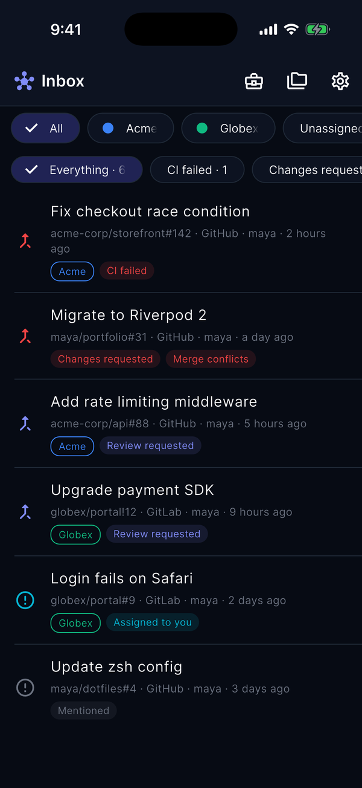
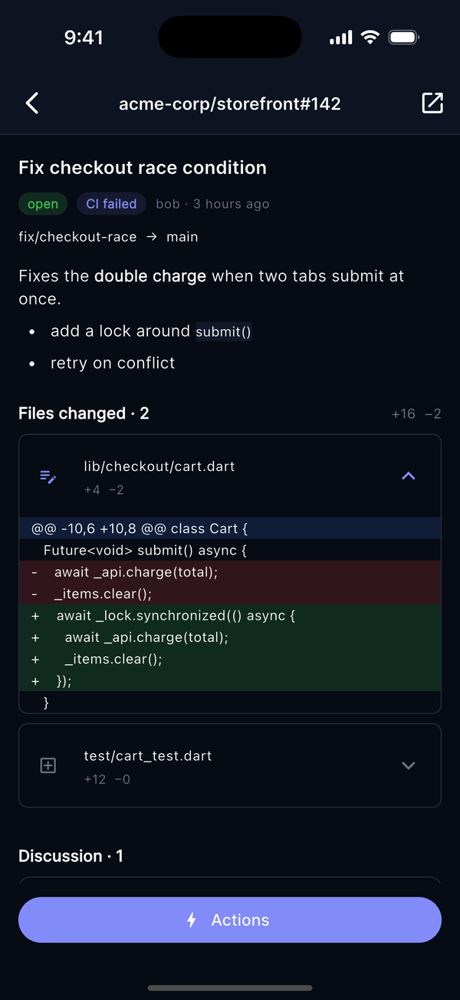
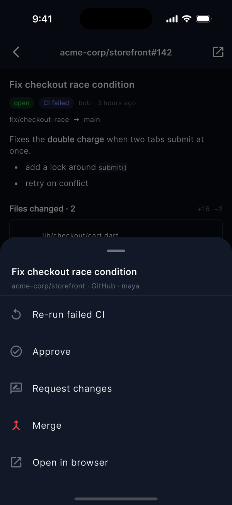
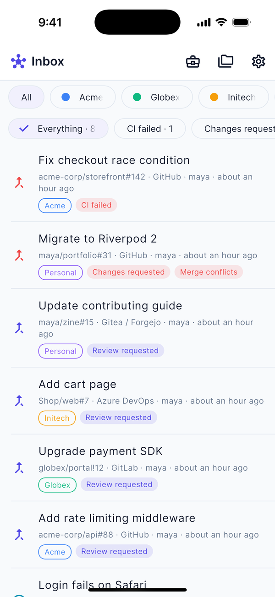
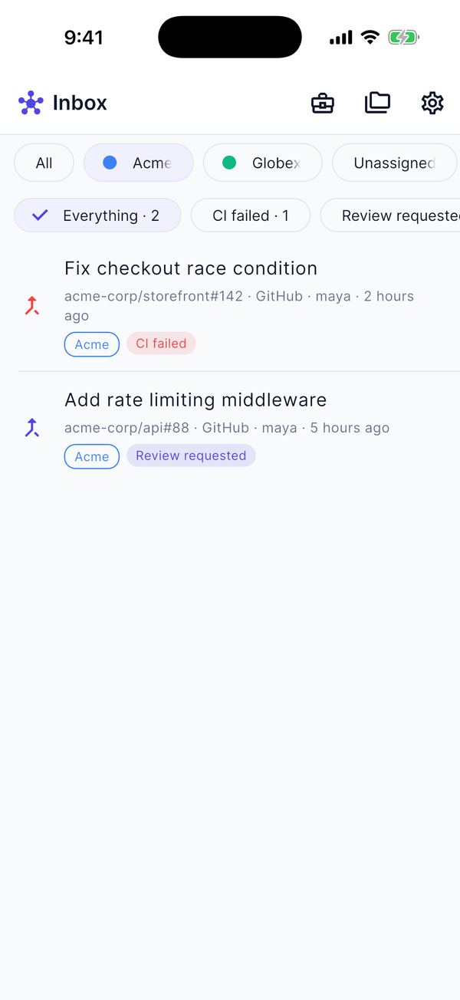
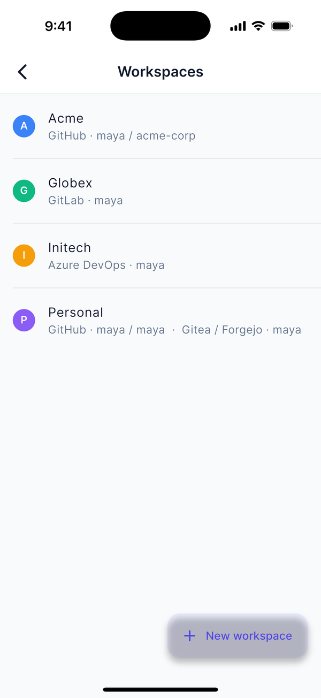
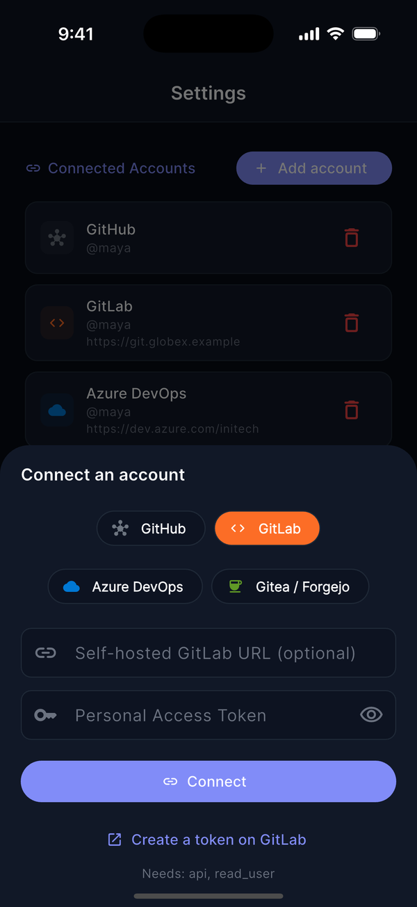
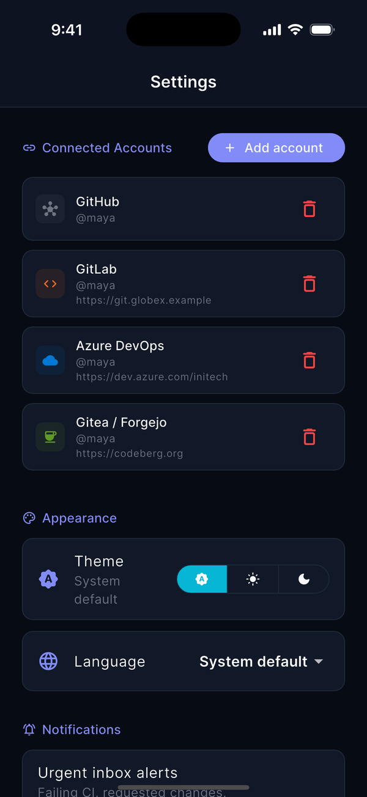
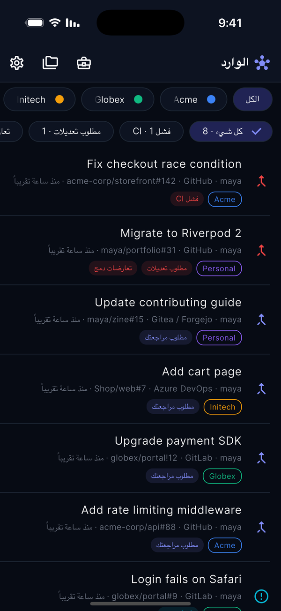

<h1 align="center">RepoSphere</h1>

<p align="center">
  <b>One inbox for everything that needs you across GitHub, GitLab, Azure DevOps and Forgejo / Gitea.</b><br>
  Failing CI, review requests, requested changes, assignments and mentions from every account, in one prioritised list you can act on without opening a browser.
</p>

<p align="center">
  <a href="https://github.com/atefelsaeed/RepoSphere/actions/workflows/ci.yml"></a>
  <a href="https://github.com/atefelsaeed/RepoSphere/releases/latest"></a>
  <a href="LICENSE"></a>
  
  
</p>

<p align="center">
  <a href="https://atefelsaeed.github.io/RepoSphere/"><b>Live demo</b></a> ·
  <a href="https://github.com/atefelsaeed/RepoSphere/releases/latest"><b>Download</b></a> ·
  <a href="doc/getting-started.md"><b>Getting started</b></a> ·
  <a href="doc/user-guide.md"><b>User guide</b></a> ·
  <a href="doc/faq.md"><b>FAQ</b></a> ·
  <a href="README.ar.md"><b>العربية</b></a>
</p>

<p align="center">
  
  
  
</p>
<p align="center"><sub>Demo data. More screenshots <a href="#screenshots">below</a>.</sub></p>

---

## Why RepoSphere?

If you work with **more than one GitHub org, a GitLab, an Azure DevOps or a self-hosted server** (a freelancer with several clients, an agency developer, a tech lead), "what do I need to do today?" means opening five tabs and five notification pages and still missing something.

RepoSphere asks every account for you and gives you **one list**, sorted by what is most urgent:

1. **CI failed** on your PR
2. **Changes requested** on your PR
3. **Merge conflicts** on your PR
4. **Review requested** from you
5. **Assigned** to you
6. **Mentioned**

Tap an item to read its diff and discussion, then **approve, request changes, merge or re-run CI** from the same screen. Swipe it away when you're done, or snooze it.

It runs **on your device**: no account to create, no server in the middle, and your tokens never leave your machine except to talk to the Git host they belong to.

## What you get

- **A unified Inbox** across GitHub, GitLab (including self-hosted), Azure DevOps and Forgejo / Gitea (Codeberg or your own server), with any number of accounts per provider.
- **Read in place**: description, changed files with a coloured diff, and the discussion.
- **Act in place**: approve, request changes, merge, re-run failed CI.
- **Triage**: swipe to mark **done** (it returns only if there is new activity) or **snooze**; filter by reason, account or client.
- **Workspaces per client**: group whole accounts *or just one org* under a client name and colour, and look at one client at a time.
- **Urgent alerts on mobile**: an optional background check that notifies you only about items that *newly* became urgent.
- **Honest about failures**: if an account can't load, or results may be incomplete (expired token, rate limit), a banner says so instead of silently showing a shorter list.
- **Fast**: opens instantly from the last snapshot while it refreshes.
- **Arabic and English**, with full right-to-left layout.
- **Everywhere**: web, macOS, Windows, Linux, Android, iOS (one Flutter codebase).
- **Also a repo browser**: repos, file tree with syntax highlighting, commits and diffs, PRs, issues, releases and more.

## Install

Everything is on the [latest release](https://github.com/atefelsaeed/RepoSphere/releases/latest) page, or just open the [live demo](https://atefelsaeed.github.io/RepoSphere/).

| Platform | What to do |
|---|---|
| **Web** | Open the [live demo](https://atefelsaeed.github.io/RepoSphere/). |
| **macOS** | `RepoSphere-macos.zip` → unzip → right-click the app → *Open* (first time). |
| **Windows** | `RepoSphere-windows-x64.zip` → unzip → run `repo_sphere.exe`. |
| **Linux** | `RepoSphere-linux-x64.tar.gz` → extract → `./repo_sphere` (needs GTK 3, libsecret and a secret service). |
| **Android** | `RepoSphere-android.apk` → install (debug-signed, for testing). |
| **iOS** | Build from source with Xcode. |

The desktop and Android builds are **not code-signed yet**, so your OS will warn you the first time. Step-by-step help and why: [Getting started](doc/getting-started.md).

## Quick start

1. **Create a token** on your Git host (the app has a *"Create a token on …"* button that opens the right page and tells you which scopes to tick).
2. **Open RepoSphere**, choose your provider (GitHub, GitLab, Azure DevOps, Forgejo / Gitea), paste the token, press **Connect**.
3. **Look at your Inbox.** Add more accounts any time from *Settings → Add account*.

Details per provider (scopes, self-hosted URLs) are in [Getting started](doc/getting-started.md).

## Supported providers

| | GitHub | GitLab | Azure DevOps | Forgejo / Gitea |
|---|:-:|:-:|:-:|:-:|
| Inbox: review requests, assignments, mentions | ✅ | ✅ | PRs and work items (no mentions) | ✅ |
| Your PRs: CI failed / changes requested / conflicts | ✅ | ✅ | changes requested (no CI status) | ✅ |
| Open an item in-app (description, diff, discussion) | ✅ | ✅ | ✅ (changed files, no line diff) | ✅ |
| Approve | ✅ | ✅ | ✅ | ✅ |
| Request changes | ✅ | — | ✅ | ✅ |
| Merge | ✅ | ✅ | ✅ | ✅ |
| Re-run failed CI | ✅ | ✅ | — | — |
| Repo browser | ✅ | ✅ | ✅ | — |
| Self-hosted servers | — | ✅ | — (cloud only) | ✅ |

GitLab's REST API has no "request changes" call. Azure DevOps has no ready-made line diff, mentions or simple CI status. Bitbucket is planned.

## Screenshots

<table>
  <tr>
    <td align="center"><br><sub>Inbox (light)</sub></td>
    <td align="center"><br><sub>One client at a time</sub></td>
    <td align="center"><br><sub>Workspaces</sub></td>
  </tr>
  <tr>
    <td align="center"><br><sub>Connect any provider</sub></td>
    <td align="center"><br><sub>Settings</sub></td>
    <td align="center"><br><sub>العربية (RTL)</sub></td>
  </tr>
</table>

## Your data and privacy

- Tokens live **on your device** in the platform's secure store (Keychain, Keystore-backed storage, Credential Manager, the system secret service). On the web build they are in the browser's local storage, so use the desktop or mobile app for long-lived tokens.
- The app talks **directly** to your Git hosts. There is **no RepoSphere server** and nothing is collected. Crash reporting is off unless *you* build with your own Sentry DSN.
- Workspaces, snoozes and the Inbox snapshot are stored locally and are not synced. **Disconnecting your last account deletes them** along with the tokens, and Android backup is off for the app.
- Links in PRs and issues open only as `http`, `https` or `mailto`; images in other people's text load only when you tap them.

More in the [FAQ](doc/faq.md#privacy-and-security). Found a vulnerability? See [SECURITY.md](SECURITY.md) and report it privately.

## Documentation

| | |
|---|---|
| [Getting started](doc/getting-started.md) | Install, create tokens per provider, connect, build from source. |
| [User guide](doc/user-guide.md) | The Inbox, labels, actions, workspaces, alerts, language. |
| [FAQ and troubleshooting](doc/faq.md) | Privacy, "my Inbox is empty", notifications, install warnings. |
| [Architecture](doc/architecture.md) | How the code is organised and how the Inbox works. |
| [CONTRIBUTING](CONTRIBUTING.md) | Setup, tests, conventions, adding a provider or a language. |
| [Security policy](SECURITY.md) | How to report a vulnerability, how tokens and links are handled, known limitations. |
| [Follow-ups](doc/follow-ups.md) | Open work to pick up later: signing, security leftovers, tests. |
| [CHANGELOG](CHANGELOG.md) | What changed in each release. |

## How it works

```
 Flutter UI ──► GitProvider (one interface, with capabilities)
                  ├─ GitHub adapter
                  ├─ GitLab adapter          ── REST, straight to each host
                  ├─ Azure DevOps adapter       (no backend, no proxy)
                  └─ Forgejo / Gitea adapter
```

Each adapter turns its host's API into the same entities, so the screens never care which provider an item came from. `ProviderCapabilities` tells the UI what each provider can do and hides the rest. See [Architecture](doc/architecture.md).

**Stack:** Flutter 3.41 · Riverpod · GoRouter · `http` · `flutter_secure_storage` · Workmanager + local notifications.

## Run from source

```bash
git clone https://github.com/atefelsaeed/RepoSphere.git
cd RepoSphere
flutter pub get
flutter run -d chrome        # or: -d macos | windows | linux | <device>
flutter test && flutter analyze
```

Optional configuration (`lib/core/config/app_config.dart`): `githubClientId` enables GitHub "Sign in" via the Device Flow, `supabaseUrl` / `supabaseAnonKey` enable optional Supabase auth, and `--dart-define=SENTRY_DSN=...` enables crash reporting. CI builds web, desktop and Android on every PR, deploys the web demo from `main`, and publishes a release when you run the *Release* workflow.

## Status and roadmap

RepoSphere is **alpha**. It is tested against mocked API responses and demo data; reports from real accounts are very welcome.

Planned: Bitbucket, a repository browser for Forgejo / Gitea, Azure DevOps mentions and CI status, a home-screen widget with the urgent count, inline review comments in the diff, more languages, and signed/notarised builds and store releases.

## Contributing

Issues and pull requests are welcome. Start with [CONTRIBUTING.md](CONTRIBUTING.md). Good first contributions: a new language, another provider (the `InboxOnlyProvider` base class makes it a four-method job), widget tests, or trying the app with a real account and reporting what's off.

## License

[MIT](LICENSE) © 2026 Atef Mahmoud Elsaeed
